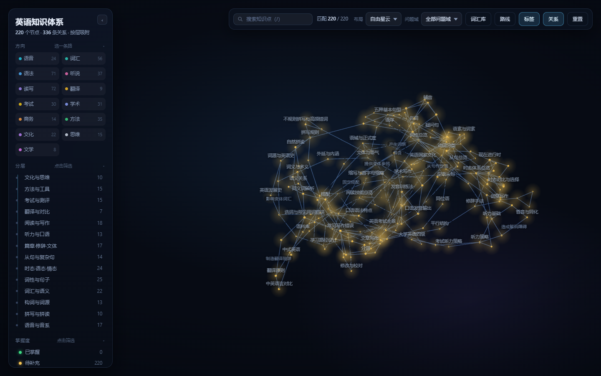
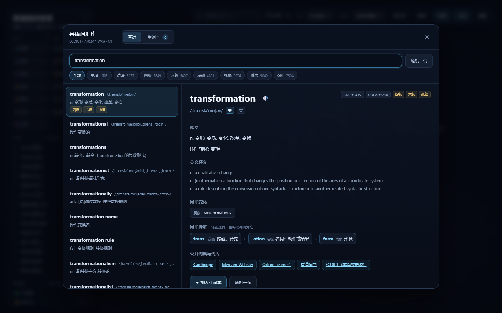
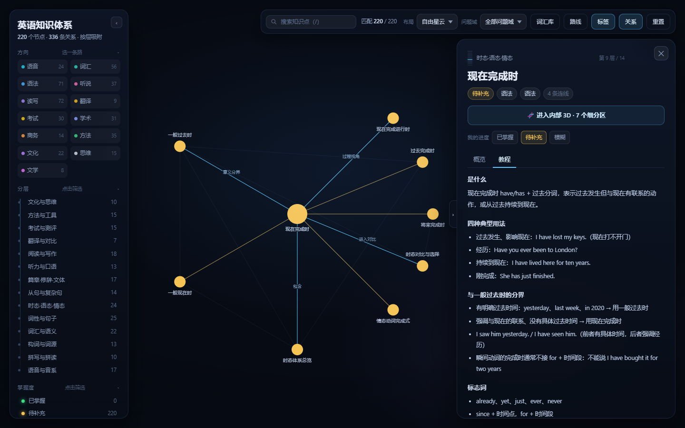

# 英语知识体系 · 3D 交互图谱

**220 个知识点、1315 条细分知识点、335 条关系、15 条学习路线、253 个学习步骤，外加一个可查询 77 万词条的英语词汇库。**

不是目录树，也不是课程表，而是一张可以转起来的英语知识地图：从语音、拼写、构词、词汇，一路到词性、时态、从句、篇章、听说读写、翻译、考试、学习方法与文化思维。每个点都能告诉你它在体系里的哪一层、属于哪些方向、学之前要先懂什么、学完之后能接上什么。

**在线体验（GitHub Pages）**：<https://renbohao888.github.io/english-knowledge-graph/>（静态版词汇库使用 1.8 万核心词；完整 77 万词条请用下面的本地 / Docker 服务）



## 覆盖范围

**14 层，从上到下：**

文化与思维 → 方法与工具 → 考试与测评 → 翻译与对比 → 阅读与写作 → 听力与口语 → 篇章·修辞·文体 → 从句与复杂句 → 时态·语态·情态 → 词性与句子 → 词汇与语义 → 构词与词源 → 拼写与拼读 → 语音与音系

**13 条方向，横切上面这些层：**

语音 / 词汇 / 语法 / 听说 / 读写 / 翻译 / 考试 / 学术 / 商务 / 方法 / 文化 / 思维 / 文学

内容覆盖到：国际音标、连读弱读、自然拼读、词根词缀、语素与构词、词义与搭配、习语与短语动词、十大词性、五种句型、12 种时态、被动语态、情态动词、虚拟语气、非谓语、名词性/定语/状语从句、长难句、衔接与修辞、标点、听力解码、影子跟读、口语流利度、阅读策略、学术写作、商务写作、中英对比、翻译技巧、高考/四六级/考研/雅思/托福/GRE/BEC、间隔重复、语料库、英语史、语用与礼貌、批判性思维与文学。

## 为什么不是一棵目录树

一张图里叠了四种信息：

| 维度 | 怎么表达 | 回答的问题 |
|---|---|---|
| **分层**（14 层） | 节点的垂直位置，左栏的分层列表 | 它在英语体系的哪一层？ |
| **方向**（13 条） | 方向模式下同一种颜色 | 我走这条路要掌握哪些？ |
| **学习路径** | 金色连线 + 流动粒子 | 先学什么，再学什么？ |
| **关系短语** | 写在连线中间的文字 | 这两个东西到底是什么关系？ |

一个节点可以同时属于多条方向。比如「搭配」同时是词汇和读写，「语音学基础」同时是语音和口语。

## 词汇库（本项目新增）

右上角「词汇库」是一个完整的查词面板，不只是查中文意思：

- **全量词库**：服务端从 `data/ecdict.db` 查询，77 万词条（学习词条远超日常需要）
- **静态核心词库**：GitHub Pages / 纯静态托管时自动使用 `src/data/vocab-core.json`，1.8 万高频词与考试词
- **词条详情**：音标、中文释义、英文释义、词性、词形变化（过去式/复数/比较级等）、Collins 星级、Oxford 3000/5000、BNC/COCA 词频排名
- **考试标签**：中考 / 高考 / 四级 / 六级 / 考研 / 托福 / 雅思 / GRE
- **词形拆解**：把长词拆成前缀 + 词根 + 后缀，每个成分可以直接跳回图谱里的「前缀 / 词根 / 后缀」节点
- **公开词典链接**：Cambridge、Merriam-Webster、Oxford Learner's、有道
- **生词本**：本地保存、导出/导入 JSON、卡片复习模式
- **发音**：浏览器 SpeechSynthesis，支持美音/英音切换

词库数据来自 [ECDICT](https://github.com/skywind3000/ECDICT)（MIT License，77 万英汉词条）。脚本只做格式转换与索引，不改写释义内容。



## 快速开始

### Python（推荐：页面 + 教程 API + 完整词汇库）

```bash
python3 scripts/build_vocab.py path/to/ecdict.csv   # 生成 data/ecdict.db 与核心词库
python3 server/api.py                                # http://127.0.0.1:8000
```

`ecdict.csv` 从 <https://github.com/skywind3000/ECDICT> 下载。没有词库文件也能启动，词汇库会自动退回静态核心词。

### Docker

```bash
docker compose up --build -d
```

打开 <http://localhost:8788>。把 `data/ecdict.db` 放进 `./data` 即可获得全量词库；页面内写的教程也保存在 `./data/content.json`，重建镜像不会丢。

### Node 本地预览（零依赖）

```bash
node scripts/serve.mjs          # Node 20+ → http://127.0.0.1:8791
```

Node 版提供静态页面与教程 API，词汇库使用静态核心词。也可以直接双击 `index.html`（首次需要联网从 CDN 取 3d-force-graph），这种打开方式下教程编辑只能存在本机浏览器。

### 开发模式

```bash
docker compose -f docker-compose.dev.yml up -d   # http://localhost:8789
```

## 搜索能细到什么程度

搜索框在右上角，按 `/` 或 `Ctrl+K` 聚焦。它不只知道节点名，还知道别名、英文名和**细分知识点**：

| 你搜 | 得到 |
|---|---|
| `音标` / `ipa` | 国际音标 IPA（节点） |
| `the` | 冠词节点的细分点「the 的特指」 |
| `连读` | 连读节点，或听力相关细分点 |
| `现在完成` | 现在完成时 |
| `非谓语` | 非谓语动词总览、动名词与不定式、分词 |
| `长难句` | 长难句分析；考研路线也会出现 |
| `雅思` | 雅思节点与相关路线 |
| `analysis` | 顶部出现「在词汇库中查询」，点一下打开词条 |

## 交互

| 操作 | 效果 |
|---|---|
| 右上「布局」 | 自由星云（默认）/ 立体螺旋 / 分层平面 三种 3D 布局互切，自动重新取景 |
| 右上「路线」 | 15 条学习链路，可在图上高亮并显示步骤序号 |
| 右上「词汇库」 | 查词、看音标与词形、加入生词本、卡片复习 |
| 左键拖拽 | 旋转；滚轮缩放；推到头继续滚 = 沿正前方穿行 |
| 右键单击 | 切换左键为「平移 / 旋转」 |
| 单击节点 | 主画面摊平成 **2D 关系图**：前置在左、后续在右、关联在下 |
| 双击节点 | 聚焦直接邻域，其余淡出 |
| 节点内部 3D | 拖动旋转以集合中心为轴固定不漂移；一直缩小自动退回该节点视图 |
| 悬停节点 / 连线 | 浮动提示；连线显示两端与关系 |
| 左上「方向」 | 只亮这一串，镜头收到包围盒上 |
| 左上「分层」 | 按层筛选（14 层按顺序列出） |
| 左上「掌握度」 | 按状态筛选，不相关节点变暗但保留位置 |
| 详情面板「我的进度」 | 标记已掌握 / 待补充 / 模糊，存在浏览器本地，可导出 |

## 学习路线（15 条，253 步）

零基础 → 四级 / 四级 → 六级 / 考研英语 / 雅思 6.5 → 7.5 / 托福 90 → 105 / 口语流利 / 听力突破 / 阅读与长难句 / 语法体系重建 / 词汇突破 / 发音矫正 / 写作体系 / 商务英语 / 学术英语 / 翻译入门。

每条路线按阶段排列，步骤分两类：

- **有节点的步骤**：点一下直接跳到图里那个知识点
- **纯动手任务**（录音、模考、精读）：可以自己打勾，进度存在浏览器里

路线的阶段划分参考了 CEFR、常见考试大纲与公开学习路径，具体到每个知识点的细分内容按本项目的体系重写。

## 教程与页面内编辑

每个知识点都是一页，地址形如 `#/present-perfect`，可以直接收藏、分享、刷新后回到这一页。详情页分两个标签：

- **概览**：一句话说明、细分知识点、前置 / 学完之后 / 其他关联
- **教程**：是什么、为什么重要、核心概念、示例、常见坑、外部链接

目前 36 个高频节点有完整教程。没有教程的节点会显示「待补」，不影响其它功能。



打开任意节点的「教程」标签，可以点 **✍ 写这篇教程 / ✏️ 编辑这篇教程**，按块组织内容。保存后写进 `data/content.json`，其他人刷新页面就能看到，不需要改代码，也不需要会 Git。服务器不可用时会退回「只存本机浏览器」。

## 数据怎么维护

数据就在 Git 里，是可 diff 的 JS 字面量，不是数据库——这样任何人都能用 PR 贡献。按主题拆成几个文件：

```
src/
├── config.js                 层、方向、颜色、共享状态
├── data/
│   ├── nodes-sound.js        语音与音系 / 拼写与拼读
│   ├── nodes-words.js        构词与词源 / 词汇与语义
│   ├── nodes-grammar.js      词性与句子 / 时态·语态·情态 / 从句与复杂句
│   ├── nodes-skills.js       篇章 / 听说 / 读写 / 翻译
│   ├── nodes-exam.js         考试 / 方法 / 文化
│   ├── links.js              基础层关系
│   ├── links-more.js         技能、考试、方法、文化关系
│   ├── paths*.js             15 条学习路线
│   ├── articles.js           教程正文
│   ├── affixes.js            词汇库的词形拆解表
│   ├── vocab-core.json       静态核心词库（构建产物，已提交）
│   └── vocab-meta.json       词库统计
├── core/                     索引、3D、进度、教程、词汇库逻辑
├── ui/                       面板、搜索、路线、标签、词汇库界面
└── main.js                   启动与渲染循环
```

加一个知识点、拆一个知识点、补一条关系，步骤都在 [CONTRIBUTING.md](CONTRIBUTING.md)。提交前跑：

```bash
node scripts/validate.mjs
```

它会检查 id 唯一、层/方向/状态合法、连线端点存在、没有重复边和自环、`before` 没有环、每个点至少 2 条边。

### 导出成数据库

```bash
npm run db        # 生成 data/knowledge.db
```

表：`nodes`、`links`、`node_tracks`、`node_before`、`node_keywords`、`node_children`。

### 重新生成词汇库

```bash
python3 scripts/build_vocab.py path/to/ecdict.csv
```

生成 `data/ecdict.db`（全量，gitignore）和 `src/data/vocab-core.json`（核心词，进仓库）。

## 设计说明

- 渲染是 **Three.js / WebGL**（通过 `3d-force-graph`），不是 CSS 假 3D。
- 三种 3D 布局：自由星云（默认，220 节点下最易读）、立体螺旋（分层塔）、分层平面（地层图）。
- 取景使用屏幕空间拟合；节点名与连线关系都是投影后用 HTML 渲染，永远正对镜头。
- 变暗是颜色向背景混合，不是改透明度。
- 连线方向：有前置关系的按「前置 → 后置」流；没有的按层从下往上流。
- `before` 里还没画成连线的那些关系，会补成「学习路径」连线：平时隐藏，选中节点或进入方向模式时才亮起金色粒子。

## 路线图

- [x] 14 层 / 13 方向 / 220 节点 / 1315 细分知识点
- [x] 学习进度存档（localStorage + 导出 / 导入 JSON）
- [x] 15 条学习路线、253 步、图上高亮、步骤序号
- [x] 节点内部 3D（全覆盖）
- [x] 页面内写 / 改教程
- [x] 词汇库：77 万词条、静态核心词、生词本、复习卡片、词形拆解
- [ ] 教程补到全部 220 个节点
- [ ] 搭配例句与真实语料例句（Tatoeba / 语料库）
- [ ] 词汇按 CEFR 分级练习与听写
- [ ] 英文界面

## 来源与许可

- 本项目基于 [renbohao888/computer-knowledge-graph](https://github.com/renbohao888/computer-knowledge-graph) 的框架重做，数据与文案全部针对英语学习重写。
- 词汇数据：[ECDICT](https://github.com/skywind3000/ECDICT)，MIT License。
- 代码：MIT，见 [LICENSE](LICENSE)。欢迎 fork、改成你们学校或团队的版本。
